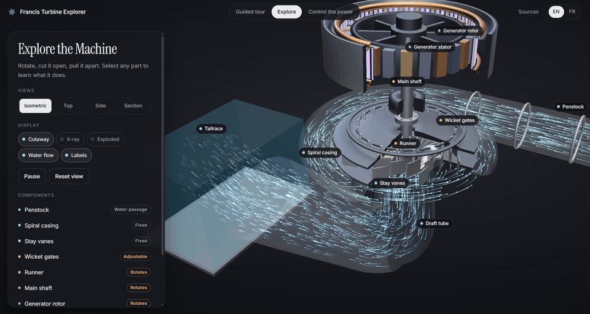

# Francis Turbine Explorer



Live demo: https://cyrilremacle-byte.github.io/francis-turbine-explorer/

An interactive, bilingual (EN / FR) exhibit that teaches how a Francis hydroelectric turbine-generator works.
Three connected modes: Guided tour (six chapters and a quiz), Explore the machine, Control the power.

## Run

```bash
npm install
npm run dev            # local dev server
npm test               # physics, geometry and translation tests
npm run build          # production build in dist/
npm run build:single   # one self-contained dist-single/index.html (no server needed)
```

No API keys, no paid services, no external 3D assets.

## Architecture

| Path | Responsibility |
| --- | --- |
| `src/physics/hydro.ts` | Power equation, illustrative flow model, synchronous speed. Pure functions with tests. |
| `src/scene/layout.ts` | Every dimension and parametric curve of the machine. Shared by solids and water. |
| `src/scene/geometry.ts` | Procedural solid geometry (spiral casing, vanes, runner blades, draft tube). |
| `src/scene/materials.ts` | Materials, cutaway planes, registry animated by the director. |
| `src/scene/Machine.tsx` | Assembly of the parts, gate linkage, induction glow, exploded view, labels. |
| `src/scene/Water.tsx` | Water pathlines through the real passages. |
| `src/scene/Scene.tsx` | Canvas, lights, per-frame director, camera choreography (GSAP), picking. |
| `src/state/store.ts`, `live.ts`, `view.ts` | Shared interaction state, per-frame state, state-to-scene resolver. |
| `src/i18n/` | Full EN and FR dictionaries. `fr.ts` is typed against `en.ts`. |
| `src/content/` | Sources and per-part metadata. |
| `src/ui/` | Top bar, tour, quiz, explore, control room, sources. |

## Accuracy notes

Verified facts and illustrative assumptions are listed in the in-app "Sources" panel.
The model is illustrative and educational. It is not a validated hydraulic or CFD simulation.
The gate opening changes flow and power, never the synchronized runner speed.

Stack: React, TypeScript, Vite, Three.js, React Three Fiber, drei, GSAP, Zustand, plain modern CSS.
The 3D model is original procedural geometry; the reference projects were studied for technique only.
